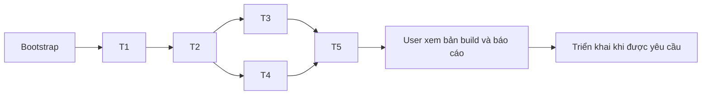

# Pickleball Hà Nội React Dashboard — Implementation Plan

> **For agentic workers:** REQUIRED SUB-SKILL: Use superpowers:subagent-driven-development (recommended) or superpowers:executing-plans to implement this plan task-by-task. Steps use checkbox (`- [ ]`) syntax for tracking.
>
> **User workflow override:** Trong Orca, chạy theo Executor được user chốt, mỗi task một Orca worktree. Không thay Orca Codex bằng Agent Tool. Task brief phải tự đủ, không yêu cầu Codex đọc CLAUDE.md hoặc skill. Chưa dispatch ở giai đoạn lập plan.

**Goal:** Xây dashboard công khai, chỉ đọc, đủ 6 mục cho đội Pickleball Hà Nội bằng React, dùng Apps Script hiện tại và GitHub Pages miễn phí.

**Architecture:** Một SPA build tĩnh, điều hướng bằng hash. Một data provider gọi simple GET tới Apps Script, kiểm tra JSON ở biên rồi chia sẻ snapshot cho 6 trang. Sheet/API giữ vai trò nguồn số liệu; frontend chỉ lọc, định dạng và tổng các danh sách có phạm vi rõ ràng.

**Tech Stack:** React, TypeScript strict, Vite, CSS thuần, Zod cho kiểm tra dữ liệu, Vitest + Testing Library cho hành vi dữ liệu, Playwright cho các luồng tích hợp. Dùng npm và package-lock.json; Node 22.12+ theo yêu cầu Vite, CI chọn Node 24.

**Spec:** [Đặc tả đã duyệt](../specs/2026-10-10-pickleball-dashboard.md).

**Trạng thái plan:** User đã duyệt plan và phân công hỗn hợp Claude/Codex ngày 10/10/2026. User đã yêu cầu bắt đầu coding ngày 10/10/2026, chỉ định Claude Sonnet 5.5 và GPT-5.6-Sol; đang bootstrap và thực thi theo bảng bên dưới. Chưa publish.

## Phân công đã duyệt và thứ tự

| Task | Executor | Model | Worktree dự kiến | Base branch | Phụ thuộc |
|---|---|---|---|---|---|
| T1 — Nền tảng và data provider | Codex | GPT-5.6-Sol | pb-t1-data | feat/pickleball-dashboard | Bootstrap Git khi bắt đầu execute |
| T2 — Giao diện chung và Tổng quan | Claude | Claude Sonnet 5.5 | pb-t2-shell | feat/pickleball-dashboard | T1 đã merge |
| T3 — Quỹ đội và Thành viên | Codex | GPT-5.6-Sol | pb-t3-finance | feat/pickleball-dashboard | T2 đã merge |
| T4 — Thi đấu, Lịch chơi, Dụng cụ | Codex | GPT-5.6-Sol | pb-t4-activities | feat/pickleball-dashboard | T2 đã merge; xác minh schema lịch/trận |
| T5 — Tích hợp, kiểm chứng, chuẩn bị Pages | Claude | Claude Sonnet 5.5 | pb-t5-release | feat/pickleball-dashboard | T3 và T4 đã merge |

Orca đặt tên branch cho từng worktree; ghi branch thực tế từ kết quả create vào bảng khi dispatch, không đoán tên. Integration branch cố định `feat/pickleball-dashboard`. T3/T4 được làm song song, sở hữu thư mục khác nhau. Phân công đã chốt: T1/T3/T4 dùng Codex; T2/T5 dùng Claude. Chỉ thay Executor khi user yêu cầu thay đổi phân công.



## Global Constraints

- Công khai, không đăng nhập; website chỉ GET, không thay đổi Sheet/API/quyền chia sẻ.
- Giữ nguyên API; không thêm Nội dung khoản chi hoặc Chứng từ vào frontend bằng một nguồn khác.
- Đủ 6 mục; một đội; GitHub Pages, repo public, tên miền miễn phí, chi phí vận hành 0 đồng trong hạn mức dịch vụ.
- Giữ phong cách mẫu, cải thiện mobile; tiền vi-VN/VND, ngày Asia/Ho_Chi_Minh.
- Giữ cách tính Sheet; không xếp hạng mới; không bù trừ khoản thiếu giữa các kỳ.
- Tải khi mở trang hoặc bấm Cập nhật; không polling, service worker, localStorage snapshot hay dữ liệu giả production.
- Mặc định kỳ hiện tại; số dư toàn đội tách khỏi thống kê danh sách lọc.
- noindex phải có trong HTML gốc/build; không commit secret hoặc dữ liệu tài chính thật làm fixture.
- Chỉ thêm dependency cần thiết. Không chart library, UI framework, backend hoặc dịch vụ auth trong bản đầu.
- Mọi worker: không sửa ngoài phạm vi task; không revert thay đổi người khác; báo thiếu interface cho coordinator.
- Không tự commit trong giai đoạn lập plan. Khi execute plan đã được duyệt, mỗi task có một commit có ý nghĩa sau kiểm chứng; không force push, không sửa lịch sử branch khác.

## Review Focus

1. HTML lỗi, ok=false hoặc numeric field sai kiểu không được trở thành dữ liệu 0 hợp lệ — T1 kiểm thử parser/fetch/provider.
2. Đóng dư ở kỳ cũ không tự bù khoản thiếu kỳ khác; dòng tiền và chi phí không bị cộng hai lần — T3 kiểm thử selectors.
3. Numeric string, dấu gạch, ngày rỗng và timezone không được biến thành hạng 0, 0% hoặc ngày 1970 — T1/T4 kiểm thử định dạng và adapters.
4. Mảng rỗng không chứng minh schema object; lịch/trận có dữ liệu chỉ render từ khóa đã xác minh — T4 contract gate và component tests.
5. Hash route, Pages subpath, lỗi refresh và mobile không phá ứng dụng đang mở — T2/T5 kiểm thử navigation và E2E bản build.

## Bản đồ file và interface

```text
.nvmrc, .gitignore, .env.example
package.json, package-lock.json, index.html
tsconfig*.json, eslint.config.js, vite.config.ts, vitest.config.ts
src/main.tsx, src/App.tsx, src/vite-env.d.ts
src/config.ts                         # URL API public
src/data/schema.ts                    # Zod boundary; TeamData/types
src/data/client.ts                    # GET + lỗi/timeouts
src/data/TeamDataProvider.tsx          # snapshot + refresh một nơi
src/data/useTeamData.ts               # hook context
src/lib/format.ts                     # VND/ngày/phần trăm theo kiểu đã xác minh
src/components/{AppShell,StatCard,DataTable,EmptyState,LoadState}.tsx
src/navigation/{sections,useSection}.ts
src/styles/{tokens,global}.css
src/features/overview/OverviewPage.tsx
src/features/finance/{FinancePage,selectors}.ts[x]
src/features/finance/finance.css
src/features/members/{MembersPage,selectors}.ts[x]
src/features/members/members.css
src/features/ranking/{RankingPage,adapters}.ts[x]
src/features/sessions/{SessionsPage,adapters}.ts[x]
src/features/assets/AssetsPage.tsx
src/features/activities.css
src/test/{setup,fixtures}.ts
src/**/*.test.ts[x]
e2e/{dashboard,errors,pages-base}.spec.ts
playwright.config.ts
.github/workflows/{ci,pages}.yml
README.md, docs/{api-contract,verification}.md
```

`{Name,other}.ts[x]` trong bản đồ là cách viết gọn; từng task bên dưới liệt kê tên file cụ thể. Không tạo file rỗng chỉ để khớp bản đồ.

### Data API dùng chung

```ts
// src/data/schema.ts — inferred từ Zod, chỉ fields API đã xác minh.
export type TeamData = z.infer<typeof teamDataSchema>;
export type PageProps = { data: TeamData };
export function parseTeamPayload(input: unknown): TeamData;

// src/data/client.ts
export function fetchTeamData(signal?: AbortSignal): Promise<TeamData>;

// src/data/useTeamData.ts
export type TeamDataState =
  | { status: 'loading'; data: null; readAt: null; error: null }
  | { status: 'error'; data: null; readAt: null; error: string }
  | { status: 'ready'; data: TeamData; readAt: Date; error: null }
  | { status: 'refreshing'; data: TeamData; readAt: Date; error: null }
  | { status: 'stale'; data: TeamData; readAt: Date; error: string };
export function useTeamData(): TeamDataState & { refresh(): void };

// Trang feature: dữ liệu lấy qua props, không fetch riêng.
// Mỗi module export named component: OverviewPage, FinancePage,
// MembersPage, RankingPage, SessionsPage, AssetsPage.
```

Tên/kiểu các property đã xác minh và chính sách với mảng chưa có mẫu nằm trong `docs/api-contract.md` do T1 tạo. Với sessions/matches/refunds, T1 chỉ dùng `z.array(z.record(z.string(), z.unknown()))` cho tới contract gate của T4; không coi đó là xác minh schema bản ghi.

`TeamDataState` định nghĩa ở `src/data/context.ts`, được re-export từ `src/data/useTeamData.ts`; PageProps và TeamData export từ schema.ts. Mọi snippet test có import tường minh từ Vitest/Testing Library và các module sở hữu được ghi ở task; không dựa vào global ngầm.

### Scripts chuẩn

```json
{
  "dev": "vite",
  "build": "tsc -b && vite build",
  "preview": "vite preview",
  "lint": "eslint .",
  "typecheck": "tsc -b --pretty false",
  "test": "vitest run",
  "test:watch": "vitest",
  "test:e2e": "playwright test"
}
```

T1 tạo tất cả scripts trừ test:e2e; T5 thêm Playwright và script test:e2e. Vitest chỉ include `src/**/*.test.{ts,tsx}`, không thu gom e2e.

## Trước khi execute — coordinator sở hữu

Executor đã được chốt. Chỉ làm khi user yêu cầu triển khai; phê duyệt plan không tự khởi chạy các task. Không thực hiện các lệnh sau trong lúc lập hoặc chốt plan.

- [ ] Xác nhận bảng Executor, nhắc lại task → agent cho user trước dispatch. Không âm thầm đổi agent khi launch lỗi.
- [ ] Khởi tạo repo hiện đang trống về Git, ghi lại spec/plan đã được duyệt, tạo integration branch:

```sh
git init -b main
git add docs/superpowers/specs/2026-10-10-pickleball-dashboard.md docs/superpowers/plans/2026-10-10-pickleball-dashboard.md
git commit -m "docs: record approved dashboard scope and implementation plan"
git switch -c feat/pickleball-dashboard
```

- [ ] Tạo mỗi worker bằng CLI đã xác minh. Ví dụ T1 nếu Executor cuối cùng là Codex; luôn chạy từ workspace integration:

```sh
/Applications/Orca.app/Contents/Resources/bin/orca worktree create --name pb-t1-data --base-branch feat/pickleball-dashboard --parent-worktree active --agent codex --prompt "Triển khai Task 1 tại docs/superpowers/plans/2026-10-10-pickleball-dashboard.md. Đọc spec được link trong plan và AGENTS.md nếu có. Chỉ sửa các file Task 1 liệt kê; không sửa file ngoài phạm vi task. Bạn không làm một mình: không revert thay đổi người khác. Kiểm chứng npm run typecheck, npm run lint, npm test, npm run build. Sau khi pass, commit feat: add typed read-only data foundation. Không sửa Sheet/API, không push/deploy. Báo kết quả và commit hash." --json
```

- [ ] Copy đúng worktree id, branch và agent terminal handle trả về. Dùng `result.agentTerminalHandle`, fallback `result.startupTerminal.handle`; nếu thiếu thì `orca terminal list` theo worktree. Không tạo agent thứ hai cùng task.
- [ ] Theo dõi `orca terminal read --terminal HANDLE --json` và `orca terminal wait --terminal HANDLE --for tui-idle --timeout-ms 60000 --json`; đọc `satisfied`, không suy luận thành công từ timeout hoặc prompt accepted.
- [ ] Xem diff và chạy checks của task, merge branch thực tế vào integration branch bằng merge thường. Không reset/force push. Tạo task phụ thuộc từ integration branch sau khi merge xong.
- [ ] T3/T4 cùng xuất phát từ integration đã có T2; không sửa cùng file. Nếu thiếu shared UI, coordinator bổ sung trước dispatch hoặc giao fix cho T5, không cho cả hai chỉnh component chung.

Trong các mẫu lệnh vận hành, HANDLE/branch là giá trị runtime được copy từ Orca, không phải phần thiết kế còn bỏ trống. Không publish hay cấp quyền cloud bằng lệnh mẫu này.

---

## Task 1: Nền tảng React, hợp đồng API và data provider

**Executor:** Codex

**Model:** gpt-5.6-sol (high)

**Depends on:** Bootstrap Git của coordinator.

**Files — ownership:**
- Create: `.nvmrc`, `.gitignore`, `.env.example`, `package.json`, `package-lock.json`, `index.html`, `tsconfig.json`, `tsconfig.app.json`, `tsconfig.node.json`, `eslint.config.js`, `vite.config.ts`, `vitest.config.ts`.
- Create: `src/main.tsx`, `src/App.tsx` (màn hình tải tối thiểu), `src/vite-env.d.ts`, `src/config.ts`.
- Create: `src/data/schema.ts`, `src/data/client.ts`, `src/data/TeamDataProvider.tsx`, `src/data/useTeamData.ts`, `src/data/context.ts`.
- Create: `src/lib/format.ts`, `src/test/setup.ts`, `src/test/fixtures.ts`, `docs/api-contract.md`.
- Test: `src/data/schema.test.ts`, `src/data/client.test.ts`, `src/data/TeamDataProvider.test.tsx`, `src/lib/format.test.ts`.
- Không sửa spec/plan, không tạo workflow, không cài Playwright trong task này.

**Interfaces:** Produces TeamData, PageProps, fetchTeamData, TeamDataProvider, useTeamData theo chữ ký ở trên; formatVnd(value: number): string, formatDate(value: string): string, formatRatio(value: number): string. `src/test/fixtures.ts` export `makeTeamData(overrides?: Partial<TeamData>): TeamData` dùng tên và số liệu tổng hợp hoàn toàn giả; `makePayload(overrides?: Partial<TeamData>)` bọc `{ok:true,data:makeTeamData(overrides)}`.

- [ ] **Step 1: Scaffold mà không xóa docs đã có.** Tạo Vite react-ts ở thư mục tạm bằng `npm create vite@latest` rồi copy các file scaffold cần thiết vào root; không chấp nhận tùy chọn xóa nội dung workspace. Hoặc dựng các file tương đương thủ công. Chọn Node 24 cho .nvmrc; giữ package-lock.

```sh
npm install react react-dom zod
npm install -D vite @vitejs/plugin-react typescript @types/react @types/react-dom @types/node eslint @eslint/js typescript-eslint eslint-plugin-react-hooks eslint-plugin-react-refresh globals vitest jsdom @testing-library/react @testing-library/jest-dom
```

- [ ] **Step 2: Thiết lập config và test environment.** Vite dùng base từ `VITE_BASE_PATH || '/'`; Vitest jsdom/setup, exclude e2e. `index.html` có lang=vi, viewport, title Pickleball Hà Nội, meta robots noindex từ đầu.

```ts
// vite.config.ts
export default defineConfig({
  plugins: [react()],
  base: process.env.VITE_BASE_PATH || '/',
});
// vitest.config.ts
export default defineConfig({
  plugins: [react()],
  test: { environment: 'jsdom', setupFiles: ['./src/test/setup.ts'],
    include: ['src/**/*.test.{ts,tsx}'] },
});
// src/test/setup.ts
import '@testing-library/jest-dom/vitest';
afterEach(() => { cleanup(); vi.unstubAllGlobals(); });
```

Import đầy đủ `defineConfig`, `react`, `afterEach`, `vi`, `cleanup` tại file tương ứng; không dựa vào global Vitest nếu chưa cấu hình types.

- [ ] **Step 3: Viết boundary tests trước parser/client.** Fixture mặc định có các object/mảng đầy đủ; số tổng hợp 0 là dữ liệu fixture hợp lệ, không phải fallback production. Các tên như An/Bình và mã kỳ test là dữ liệu tự dựng.

```ts
it('rejects malformed money instead of rendering zero', () => {
  const payload = makePayload();
  const malformed: unknown = { ...payload, data: { ...payload.data,
    overview: { ...payload.data.overview, balance: '' } } };
  expect(() => parseTeamPayload(malformed)).toThrow();
});
it('accepts a valid empty sessions array', () => {
  expect(parseTeamPayload(makePayload()).sessions).toEqual([]);
});
it('rejects application-level errors', () => {
  expect(() => parseTeamPayload({ ok: false, error: 'failed' })).toThrow();
});
it('uses only public simple GET', async () => {
  const fetchMock = vi.fn().mockResolvedValue(new Response(JSON.stringify(makePayload()),
    { status: 200, headers: { 'Content-Type': 'application/json' } }));
  vi.stubGlobal('fetch', fetchMock);
  await fetchTeamData();
  const options = fetchMock.mock.calls[0][1];
  expect(options.method).toBe('GET');
  expect(options.credentials).toBe('omit');
  expect(options.headers).toBeUndefined();
  expect(options.mode).not.toBe('no-cors');
});
```

Run `npm test -- src/data/schema.test.ts src/data/client.test.ts`; expected FAIL trước khi có implementation. Thêm case HTTP 500, HTML response, JSON thiếu overview, schemaVersion không hỗ trợ và timeout.

- [ ] **Step 4: Ghi hợp đồng đã quan sát, rồi implement Zod schema.** Liệt kê từng field từ spec/bản GET read-only; nhận finite number cho tiền/thống kê, string cho date/name/status, number|string cho rank/winRate/quantity nơi dữ liệu thật có chuỗi. Không dùng `z.coerce.number()` cho ô rỗng. Unknown extra object keys được bỏ qua; missing required arrays/overview là lỗi, không default []/0.

```ts
const finite = z.number().finite();
const unverifiedRows = z.array(z.record(z.string(), z.unknown()));
const overviewSchema = z.object({
  fundPeriod: z.string(), normalFee: finite, studentFee: finite,
  openingBalance: finite, totalIncome: finite, totalFundOutflow: finite,
  totalRefunded: finite, balance: finite, totalExpenses: finite,
  regularMembers: finite, periodRequired: finite, periodPaid: finite,
  periodMissing: finite, fullyPaidMembers: finite,
});
// teamDataSchema gồm overviewSchema và schema cho mọi field đã xác minh;
// sessions, matches, refunds dùng unverifiedRows tới contract gate T4.
export function parseTeamPayload(input: unknown): TeamData {
  const payload = z.object({ ok: z.literal(true), data: teamDataSchema }).parse(input);
  return payload.data;
}
```

`docs/api-contract.md` phải có đầy đủ field/type các mảng đã có bản ghi, schemaVersion=1, timestamps/timezone, các trường thiếu so với Sheet, và đánh dấu rõ ba mảng chưa có mẫu. Không copy toàn bộ payload thật vào docs hoặc fixture.

- [ ] **Step 5: Client giữ URL /exec và theo redirect.** API URL từ `import.meta.env.VITE_APPS_SCRIPT_URL` hoặc constant URL công khai trong spec. Timeout 20 giây; gọi simple GET, credentials omit, redirect follow, không custom headers và không JSONP/no-cors. Phân loại abort do unmount với timeout; kiểm tra HTTP status rồi parse JSON/schema.

```ts
const response = await fetch(API_URL, {
  method: 'GET', credentials: 'omit', redirect: 'follow',
  cache: 'no-store', signal: requestSignal,
});
if (!response.ok) throw new Error('Không tải được dữ liệu. Vui lòng thử lại.');
return parseTeamPayload(await response.json());
```

requestSignal phối hợp caller signal và timeout controller, clear timer trong finally; không hardcode URL googleusercontent redirect và không log payload.

- [ ] **Step 6: Data provider một snapshot.** Tải khi mount, refresh nút chung; chống request chồng khi đang tải; abort cleanup. Refresh lỗi giữ data/readAt cũ và chuyển stale. Một context chung được main.tsx bọc ngoài App; feature không mount provider lại khi đổi tab. Lỗi lần đầu data=null; không lấy fallback 0.

Test bằng renderHook/render với mocked client: lần đầu fail là error/null; refresh fail giữ cùng snapshot/readAt; refresh thành công đổi readAt; unmount không ghi state sau request. Dùng deferred promise và fake timers, không sleep thật.

- [ ] **Step 7: Format helpers và kiểm chứng.** `formatDate('')` trả '—'; ISO +07 không bị lệch ngày; invalid date trả '—'. formatRatio chỉ nhận tỷ lệ số đã xác minh, chuỗi '—' được view giữ nguyên. Money không cắt số âm hoặc precision bằng parseInt.

```ts
expect(formatDate('')).toBe('—');
expect(formatDate('2026-10-09T00:00:00+07:00')).toBe('09/10/2026');
expect(formatRatio(0.5)).toMatch(/50/);
expect(formatVnd(-100000)).toMatch(/100[.\s]000/);
expect(formatVnd(-100000)).toContain('-');
```

Run `npm run typecheck`, `npm run lint`, `npm test`, `npm run build`; expected all pass, dist/index.html có noindex và bundle không chứa fixture.

- [ ] **Step 8: Commit trong task execution:** stage đúng file ownership, `git commit -m "feat: add typed read-only data foundation"`. Báo commit hash, checks, schema chưa xác minh. Không push/deploy.

---

## Task 2: Giao diện chung, điều hướng và Tổng quan

**Executor:** Claude

**Model:** claude-sonnet-5-5

**Depends on:** T1 đã merge.

**Files — ownership:**
- Modify: `src/App.tsx`, `src/main.tsx` (import global CSS).
- Create: `src/navigation/sections.ts`, `src/navigation/useSection.ts`, `src/styles/tokens.css`, `src/styles/global.css`.
- Create: `src/components/AppShell.tsx`, `src/components/StatCard.tsx`, `src/components/DataTable.tsx`, `src/components/EmptyState.tsx`, `src/components/LoadState.tsx`.
- Create: `src/features/overview/OverviewPage.tsx`.
- Test: `src/navigation/useSection.test.tsx`, `src/features/overview/OverviewPage.test.tsx`.
- Không sửa schema/client/package files hoặc tạo file feature T3/T4.

**Interfaces:**

```ts
export type Section = 'overview' | 'finance' | 'members' | 'ranking' | 'sessions' | 'assets';
export function useSection(): Section;
export type Column<Row> = { id: string; header: string; render(row: Row): ReactNode };
export type DataTableProps<Row> = { caption: string; rows: Row[];
  columns: Column<Row>[]; rowKey(row: Row): string; emptyMessage?: string };
// AppShell: { children: ReactNode; section: Section; state: TeamDataState; onRefresh(): void }
// StatCard: { label: string; value: ReactNode; note?: string }
// EmptyState: { title: string; description?: string; action?: ReactNode }
// LoadState: { state: TeamDataState; onRetry(): void }
// OverviewPage: PageProps, không fetch.
```

- [ ] **Step 1: Bắt đầu từ tokens và shell responsive.** Tạo header/logo chữ, 6 anchor hash, nút Cập nhật, main và footer. Nền #f7f7f2, xanh #315747, text #24372d, border #d9dfd6; system sans, heading serif. Header sticky chỉ khi không che nội dung; mobile nav wrap hoặc cuộn riêng. Focus visible, aria-current, skip link.

```css
:root { --bg: #f7f7f2; --ink: #24372d; --brand: #315747;
  --line: #d9dfd6; --surface: #fff; --radius: 12px; }
*, *::before, *::after { box-sizing: border-box; }
body { margin: 0; background: var(--bg); color: var(--ink); }
.container { width: min(100% - 2rem, 1180px); margin-inline: auto; }
.table-scroll { max-width: 100%; overflow-x: auto; }
:focus-visible { outline: 3px solid var(--brand); outline-offset: 3px; }
```

- [ ] **Step 2: Test rồi implement hash navigation.** useSection đọc hash ban đầu, subscribe hashchange, cleanup; unknown/empty trả overview. Link là anchor thật, giữ browser history. Tại task này các trang ngoài overview có panel thông báo tích hợp ở T5 trong App.tsx; không tạo fake data hoặc file placeholder ở thư mục worker khác.

```ts
it('supports direct finance hash and browser hash changes', () => {
  window.location.hash = '#finance';
  const { result } = renderHook(() => useSection());
  expect(result.current).toBe('finance');
  act(() => {
    window.location.hash = '#assets';
    window.dispatchEvent(new HashChangeEvent('hashchange'));
  });
  expect(result.current).toBe('assets');
});
```

Thêm unknown hash → overview. Run `npm test -- src/navigation/useSection.test.tsx` fail rồi pass.

- [ ] **Step 3: Shared table và load states.** DataTable dùng table/caption/thead/tbody, cells qua render ReactNode; EmptyState tách mảng rỗng với lỗi; LoadState cho first loading/error/stale. App chỉ render feature khi state.data khác null; refresh và stale vẫn giữ feature cũ. Nút Cập nhật disable/aria-busy trong loading/refreshing.

```tsx
<div className="table-scroll" role="region" aria-label={caption} tabIndex={0}>
  <table><caption>{caption}</caption>
    <thead><tr>{columns.map(c => <th key={c.id} scope="col">{c.header}</th>)}</tr></thead>
    <tbody>{rows.map(row => <tr key={rowKey(row)}>
      {columns.map(c => <td key={c.id}>{c.render(row)}</td>)}
    </tr>)}</tbody>
  </table>
</div>
```

- [ ] **Step 4: Tổng quan dùng trực tiếp overview.** Thẻ số dư toàn đội, totalIncome, totalFundOutflow, totalExpenses; khu riêng fundPeriod/periodRequired/periodPaid/periodMissing/fullyPaidMembers. Không cộng income/expenses để thay số overview.

```ts
it('renders upstream balance separately from period payments', () => {
  const data = makeTeamData();
  data.overview.balance = 1200000;
  data.overview.periodPaid = 300000;
  render(<OverviewPage data={data} />);
  expect(screen.getByText('Số dư quỹ toàn đội')).toBeInTheDocument();
  expect(screen.getByText(formatVnd(1200000))).toBeInTheDocument();
  expect(screen.getByText(formatVnd(300000))).toBeInTheDocument();
});
```

- [ ] **Step 5: Kiểm chứng và commit.** Run `npm run typecheck`, `npm run lint`, `npm test`, `npm run build`. Xem browser local ở 390px và desktop: header/tab/focus/bảng không tràn ngang toàn trang. Commit `feat: add responsive dashboard shell and overview`; báo shared component interfaces cho T3/T4.

---

## Task 3: Quỹ đội và Thành viên

**Executor:** Codex

**Model:** gpt-5.6-sol (high)

**Depends on:** T2 đã merge. Có thể chạy song song với T4.

**Files — ownership:**
- Create: `src/features/finance/FinancePage.tsx`, `src/features/finance/selectors.ts`, `src/features/finance/finance.css`.
- Create: `src/features/members/MembersPage.tsx`, `src/features/members/selectors.ts`, `src/features/members/members.css`.
- Test: `src/features/finance/selectors.test.ts`, `src/features/finance/FinancePage.test.tsx`, `src/features/members/MembersPage.test.tsx`.
- Không sửa App.tsx, shared components, data layer, config, lockfile, fixture chung hoặc thư mục ranking/sessions/assets. Tạo fixture đặc thù trong test riêng bằng makeTeamData.

**Interfaces:** Consumes PageProps, format helpers, DataTable/StatCard/EmptyState của T1/T2. Produces named FinancePage, MembersPage và các pure selectors:

```ts
type IncomeRow = TeamData['income'][number];
type ExpenseRow = TeamData['expenses'][number];
export type IncomeFilter = { period: string; member: string; status: string };
export type ExpenseFilter = { from: string; to: string; category: string; paidBy: string };
export function selectIncome(rows: IncomeRow[], filter: IncomeFilter): IncomeRow[];
export function selectExpenses(rows: ExpenseRow[], filter: ExpenseFilter): ExpenseRow[];
export function summarizeIncome(rows: IncomeRow[]): { required: number; paid: number; missing: number };
export function summarizeExpenses(rows: ExpenseRow[]): { amount: number; recordedExpense: number;
  fundOutflow: number; refunded: number; refundRemaining: number };
// members/selectors.ts
export function selectMembers(rows: TeamData['members'], query: string, status: string): TeamData['members'];
```

- [ ] **Step 1: Viết selector tests cho các trường hợp có thể sai tiền.** Dùng makeTeamData và literal override bản ghi tổng hợp trong test, không copy dữ liệu thật.

```ts
it('does not offset missing dues with overpayment from another row', () => {
  const base = makeTeamData().income[0];
  const rows = [
    { ...base, period: 'OLD', required: 1000000, paid: 1070000, missing: 0 },
    { ...base, period: 'NEW', required: 1000000, paid: 0, missing: 1000000 },
  ];
  expect(summarizeIncome(rows)).toEqual({ required: 2000000, paid: 1070000, missing: 1000000 });
});
it('keeps expense recognition separate from fund outflow and refund', () => {
  const base = makeTeamData().expenses[0];
  const rows = [{ ...base, amount: 500000, recordedExpense: 500000,
    fundOutflow: 200000, refunded: 200000, refundRemaining: 300000 }];
  expect(summarizeExpenses(rows)).toEqual({ amount: 500000, recordedExpense: 500000,
    fundOutflow: 200000, refunded: 200000, refundRemaining: 300000 });
});
```

`makeTeamData` phải có ít nhất một synthetic income/expense row để làm base; arrays sessions/matches/refunds vẫn empty. Thêm case kỳ LS-* lọc bằng equality, receivedAt rỗng vẫn giữ dòng thu, khoảng ngày inclusive theo Asia/Ho_Chi_Minh, ngày không hợp lệ không giả thành hôm nay. Run `npm test -- src/features/finance/selectors.test.ts` fail trước implement.

- [ ] **Step 2: Implement selectors không mutate data.** Filters rỗng là tất cả; period bắt đầu bằng overview.fundPeriod, option lịch sử lấy unique period thực tế. Các tổng cộng từng field API, không dựng missing bằng phép trừ. Chi không có period nên không được dùng kỳ thu để lọc.

```ts
export function summarizeIncome(rows: IncomeRow[]) {
  return rows.reduce((sum, row) => ({
    required: sum.required + row.required,
    paid: sum.paid + row.paid,
    missing: sum.missing + row.missing,
  }), { required: 0, paid: 0, missing: 0 });
}
```

Date input YYYY-MM-DD so sánh với day key trong timezone Việt Nam được lấy từ Date/Intl, không so sánh chuỗi dd/mm hoặc parse theo locale máy.

- [ ] **Step 3: FinancePage có 3 vùng rõ.** Thu quỹ: kỳ/người/trạng thái, totals theo lọc, bảng required/paid/missing/status/receivedAt/method. Chi quỹ: ngày/nhóm/người thanh toán, bảng date/category/amount/paidBy/source; nhãn tiền chi phí và tiền ra khỏi quỹ tách biệt. Ứng/hoàn ứng: dùng advances member/advanced/refunded/remaining/status. Không thêm cột Nội dung/Chứng từ hoặc bảng lịch sử refunds chưa xác minh.

```tsx
const [period, setPeriod] = useState(data.overview.fundPeriod);
const rows = selectIncome(data.income, { period, member, status });
const totals = summarizeIncome(rows);
// Nếu user chưa đổi kỳ, refresh fundPeriod mới thì theo kỳ mới;
// nếu user đã chọn lịch sử, giữ lựa chọn còn tồn tại.
```

Component test chọn kỳ lịch sử, kiểm tra visible row và sum; kiểm tra không hiện cột không có dữ liệu API. Empty do filter có nút Xóa bộ lọc; empty nguồn dùng Chưa có dữ liệu.

- [ ] **Step 4: MembersPage giữ số liệu API.** Tìm tên không phân biệt hoa/thường, lọc status; bảng tài chính từng người và thống kê số buổi/số trận/thắng/thua. Không recompute missing từ required-paid; người matches=0 hiển thị Chưa thi đấu/dấu gạch ở tỷ lệ phù hợp. Định dạng tỷ lệ số theo công thức Sheet; không parse chuỗi dấu gạch thành 0.

```ts
it('shows reported missing amount rather than recomputing it', () => {
  const data = makeTeamData();
  data.members = [{ ...data.members[0], name: 'An', required: 2000000,
    paid: 1070000, missing: 1000000 }];
  render(<MembersPage data={data} />);
  expect(screen.getByText(formatVnd(1000000))).toBeInTheDocument();
});
```

- [ ] **Step 5: Kiểm chứng/commit.** Run `npm run typecheck`, `npm run lint`, `npm test -- src/features/finance src/features/members`, `npm run build`. Kiểm tra component bằng fixtures không cần App routing. Commit `feat: add finance and member views`; báo file exports để T5 tích hợp. Không sửa file ngoài ownership.

---

## Task 4: Thi đấu, Lịch chơi và Dụng cụ

**Executor:** Codex

**Model:** gpt-5.6-sol (high)

**Depends on:** T2 đã merge. Có thể chạy song song với T3.

**Files — ownership:**
- Create: `src/features/ranking/RankingPage.tsx`, `src/features/ranking/adapters.ts`.
- Create: `src/features/sessions/SessionsPage.tsx`, `src/features/sessions/adapters.ts`.
- Create: `src/features/assets/AssetsPage.tsx`, `src/features/activities.css`.
- Test: `src/features/ranking/RankingPage.test.tsx`, `src/features/ranking/adapters.test.ts`, `src/features/sessions/SessionsPage.test.tsx`, `src/features/sessions/adapters.test.ts`, `src/features/assets/AssetsPage.test.tsx`.
- Modify: `docs/api-contract.md` chỉ mục sessions/matches và bằng chứng xác minh. Không sửa App/schema/shared components/config/package/lockfile hoặc finance/members.

**Interfaces:** Produces named RankingPage, SessionsPage, AssetsPage, mỗi component nhận PageProps. Adapters nhận raw record và trả union, không throw trong render:

```ts
type InvalidRecord = { ok: false; reason: string };
export type SessionView = { id: string; date: string; activity: string;
  court: string; start: string; end: string; attendees: string[] | null;
  attendanceCount: number | null; totalCost: number | null; status: string };
export type MatchView = { date: string; team1: string[]; team2: string[];
  score1: number; score2: number; sessionId: string | null };
export function toSessionView(row: Record<string, unknown>): { ok: true; value: SessionView } | InvalidRecord;
export function toMatchView(row: Record<string, unknown>): { ok: true; value: MatchView } | InvalidRecord;
```

View types là interface frontend đã chọn; KHÔNG tuyên bố đó là tên khóa upstream. Adapter map chính xác từ khóa JSON đã được contract gate xác minh. Trường API thực sự không cung cấp là null/dấu gạch, không suy luận hoặc đọc Sheet trực tiếp.

- [ ] **Step 1: Contract gate read-only trước adapter có dữ liệu.** Đọc mã xuất JSON của Apps Script hiện có nếu user/connector/browser đã có quyền; hoặc quan sát bản GET có dữ liệu tự nhiên. Endpoint GET đang empty không đủ. Cột Sheet chỉ hỗ trợ hiểu ý nghĩa, không chứng minh JSON key.

Ghi tên khóa, kiểu, ví dụ synthetic thay tên/giá trị thật, nguồn bằng chứng và cách xử lý ô rỗng vào docs/api-contract.md. Không POST, không chèn dữ liệu, không sửa script. Nếu không đọc được mã và API vẫn rỗng, báo coordinator để xin user đoạn export JSON liên quan; vẫn làm ranking/assets/empty states nhưng không mark task complete hoặc claim support nonempty sessions/matches. Không chọn khóa phỏng đoán để vượt gate.

- [ ] **Step 2: Tests rỗng, chưa thi đấu và quantity string.** Những case sau dùng contract đã có, có thể làm ngay trong khi chờ gate:

```ts
it('shows an empty calendar without invented sessions', () => {
  render(<SessionsPage data={makeTeamData({ sessions: [] })} />);
  expect(screen.getByText('Chưa có dữ liệu lịch chơi')).toBeInTheDocument();
});
it('does not award a rank to a player with zero matches', () => {
  const data = makeTeamData();
  data.ranking = [{ ...data.ranking[0], member: 'Bình', matches: 0, rank: '—', winRate: '—' }];
  render(<RankingPage data={data} />);
  expect(screen.getByText('Chưa thi đấu')).toBeInTheDocument();
});
it('preserves unknown asset quantities instead of converting them to zero', () => {
  const data = makeTeamData();
  data.assets = [{ ...data.assets[0], name: 'Bóng thử nghiệm', remaining: '—' }];
  render(<AssetsPage data={data} />);
  expect(screen.getByText('Bóng thử nghiệm')).toBeInTheDocument();
  expect(screen.getAllByText('—').length).toBeGreaterThan(0);
});
```

Run `npm test -- src/features/ranking src/features/sessions src/features/assets` fail trước implementation. Test fixtures không dùng API thật.

- [ ] **Step 3: RankingPage theo thứ tự upstream.** Bảng rank/member/matches/wins/losses/pointsFor/pointsAgainst/pointDifference/winRate; member chưa chơi có dấu gạch/Chưa thi đấu, không top-3 highlight. Không reorder bằng metric tự chọn. Hiển thị lịch sử trận bằng adapter đã xác minh; không suy ra kết quả từ tổng thắng/thua.

- [ ] **Step 4: SessionsPage và adapters sau gate.** Danh sách ngày, sân, giờ, người hoặc số người nếu API chỉ cho số lượng, totalCost/status. Lọc ngày/trạng thái nếu field có trong contract; date Việt Nam; sắp ngày mới nhất, không mutating snapshot. Không có raw field thì bỏ nhãn dữ liệu đó hoặc dấu gạch có nghĩa; không tạo lịch mặc định.

Viết thêm test adapter dùng một synthetic record có đúng khóa từ contract đọc được: map giờ/ngày/chi phí đúng, record thiếu required field trả `{ok:false}`. Component báo số bản ghi không đọc được; không coi toàn mảng lỗi là Chưa có dữ liệu.

- [ ] **Step 5: AssetsPage.** Bảng quantity strings giữ nguyên, giá trị tiền dùng finite number đã validate, ngày rỗng dấu gạch, người giữ/status giữ nguyên text. Tìm tên và lọc tình trạng lấy unique status trong dữ liệu. Không tự tính lại số còn lại hoặc thêm giao dịch tồn kho.

```tsx
// quantity đã là dữ liệu hiển thị upstream, giữ chuỗi số hoặc dấu gạch.
const quantityText = (value: string | number) =>
  typeof value === 'string' && value.trim() === '' ? '—' : String(value);
```

- [ ] **Step 6: Kiểm chứng/commit.** Run `npm run typecheck`, `npm run lint`, `npm test -- src/features/ranking src/features/sessions src/features/assets`, `npm run build`. Task chỉ hoàn tất khi contract gate + case nonempty đã chứng minh hoặc user chính thức điều chỉnh phạm vi. Commit `feat: add ranking schedule and asset views`; báo exports, contract evidence và checks. Không sửa ngoài ownership.

---

## Task 5: Tích hợp, kiểm chứng bản build và chuẩn bị GitHub Pages

**Executor:** Claude

**Model:** claude-sonnet-5-5

**Depends on:** T3/T4 đã merge; không còn worker khác sửa source.

**Files — ownership:**
- Modify: `src/App.tsx`, `package.json`, `package-lock.json`, `vite.config.ts`, `index.html` nếu cần tích hợp.
- Create: `playwright.config.ts`, `e2e/dashboard.spec.ts`, `e2e/errors.spec.ts`, `e2e/pages-base.spec.ts`, `.github/workflows/ci.yml`, `.github/workflows/pages.yml`, `README.md`, `docs/verification.md`.
- Integration fixes: được sửa file src/tests từ T1–T4 để sửa lỗi đã chứng minh; báo rõ từng sửa và kiểm thử liên quan, không refactor ngoài phạm vi.

**Interfaces:** Consumes toàn bộ named pages, TeamDataProvider/useTeamData, Section, synthetic fixtures. Produces bản build tĩnh, workflow CI/Pages chưa publish, tài liệu vận hành và báo cáo chứng cứ.

- [ ] **Step 1: Tích hợp đủ 6 route, không thêm fetch theo page.** App route map typed và chỉ render data khác null. Giữ data provider tại main, không key provider theo section. Loại mọi panel tích hợp tạm trong T2.

```tsx
const pages: Record<Section, ComponentType<PageProps>> = {
  overview: OverviewPage, finance: FinancePage, members: MembersPage,
  ranking: RankingPage, sessions: SessionsPage, assets: AssetsPage,
};
const Page = pages[section];
return <AppShell section={section} state={state} onRefresh={state.refresh}>
  <LoadState state={state} onRetry={state.refresh} />
  {state.data && <Page data={state.data} />}
</AppShell>;
```

- [ ] **Step 2: Playwright kiểm tra production build tại subpath.** Cài dev dependency và browser Chromium. Test command build với `VITE_BASE_PATH=/PickleballTeam/`, preview 127.0.0.1:4173 strict port. CI chỉ Chromium cho phạm vi nhỏ; kiểm tra mobile bằng viewport và desktop.

```sh
npm install -D @playwright/test
npx playwright install chromium
VITE_BASE_PATH=/PickleballTeam/ npm run build
npm run preview -- --host 127.0.0.1 --port 4173 --strictPort
```

Config webServer có cùng build/preview command, timeout 120000, reuseExistingServer=false để không vô tình test bản dev; testDir=e2e, baseURL=http://127.0.0.1:4173/PickleballTeam/. Dùng route mock URL /exec trong test deterministic, không giữ payload thật.

```ts
test('opens and reloads finance under the Pages project path', async ({ page }) => {
  await page.route('https://script.google.com/macros/s/**/exec', route =>
    route.fulfill({ json: makePayload() }));
  await page.goto('./#finance');
  await expect(page.getByRole('heading', { name: 'Quỹ đội', exact: true })).toBeVisible();
  await page.reload();
  await expect(page.getByRole('heading', { name: 'Quỹ đội', exact: true })).toBeVisible();
});
```

Thêm tests: 6 link routes, Back/Forward, không refetch do đổi tab/filter, click refresh có request mới; API HTTP lỗi/HTML/ok=false/timeout không hiện balance 0; refresh lỗi giữ số/timestamp cũ và hiện stale; HTML build có noindex; malicious text từ Sheet hiển thị nguyên text không chạy HTML; mobile 390px document.scrollWidth <= innerWidth.

- [ ] **Step 3: CI và deploy config không chứa tên tài khoản hardcoded.** CI chạy npm ci/typecheck/lint/test/build/E2E Node24; lockfile committed. Pages workflow manual `workflow_dispatch` ban đầu, không tự publish khi chỉ push code chuẩn bị. Đặt permissions contents:read, pages:write, id-token:write; GitHub environment github-pages, concurrency pages. Dùng actions/configure-pages/upload-pages-artifact/deploy-pages theo official Vite example, chọn current stable major được official docs xác nhận lúc implement.

Base path tính từ repo GitHub thực tế, không hardcode /PickleballTeam/ khi repository khác tên:

```sh
repo_name="${GITHUB_REPOSITORY#*/}"
repo_owner="${GITHUB_REPOSITORY%/*}"
if [ "$repo_name" = "$repo_owner.github.io" ]; then
  export VITE_BASE_PATH=/
else
  export VITE_BASE_PATH="/$repo_name/"
fi
npm run build
```

T5 dùng code này trong build workflow, không chạy push/dispatch/enable Pages. API public URL có thể dùng default config; không yêu cầu secret hoặc token frontend.

- [ ] **Step 4: Kiểm chứng live read-only và đối soát.** Chạy browser với API thật ở local preview để phát hiện CORS/redirect/schema. Đọc Sheet bằng connector tại cùng thời điểm để đối chiếu overview: balance, totalIncome, totalFundOutflow, totalRefunded, totalExpenses, periodRequired/Paid/Missing. Nếu lệch do nguồn thay đổi, đọc lại một lần theo cùng snapshot; không sửa số nguồn/ghi đè frontend để ép khớp.

Kiểm tra tổng qua fixtures là test tự động; số live không hardcode vào assertion CI. Ghi thời điểm, field đối chiếu, pass/fail và các giới hạn còn lại vào docs/verification.md, không dump payload thật. Quota/lỗi mạng live không được làm mất suite deterministic đã pass; vẫn báo rõ live check chưa pass nếu xảy ra.

- [ ] **Step 5: Tài liệu và kết quả để user review.** README có Node/npm scripts, public URL API, thao tác cập nhật Sheet rồi Cập nhật web, giải thích noindex không phải đăng nhập, xử lý lỗi nguồn, cách deploy/rollback phiên bản website. Không hứa backup Sheet tự động: không thay Apps Script/Sheet trong phạm vi này.

Run `npm run typecheck`, `npm run lint`, `npm test`, `npm run build`, `npm run test:e2e`. Xem browser production build desktop/mobile và chụp màn hình 6 mục/trạng thái lỗi cần thiết vào artifact local ngoài repo. Kiểm tra `dist/index.html` có noindex, bundle không import src/test/fixtures, repo không chứa env private hoặc snapshot thật.

- [ ] **Step 6: Commit và bàn giao.** Commit `feat: integrate dashboard and prepare GitHub Pages release`. Báo commit hash, checks, đường dẫn preview/screenshots, các gate chưa hoàn tất. Không coi Task5 đạt nếu T4 chưa xác minh lịch/trận mà chưa có quyết định thay đổi phạm vi của user.

## Triển khai public — bước sau plan, khi user yêu cầu

- Chuẩn bị xong bản build + báo cáo trước khi xin quyết định publish; không hỏi quyền sớm trong lúc implementation còn dang dở.
- Xác định repo public đích trong tài khoản GitHub đã kết nối, tránh trùng hoặc ghi đè repo có sẵn. Tên đề xuất PickleballTeam, URL dự kiến https://thientran2910.github.io/PickleballTeam/ nếu repo thực tế đúng tên/account này.
- Khi được yêu cầu triển khai: tạo/liên kết repo, push branch đã duyệt, bật Pages source GitHub Actions, dispatch workflow; chỉ bật deploy theo push main nếu user muốn cơ chế đó.
- Xác nhận workflow thành công và test URL public trong browser không đăng nhập: JSON/CORS thật, 6 hash routes, reload, Cập nhật, noindex, mobile. Không kết luận deploy thành công chỉ từ artifact upload.
- Rollback web bằng commit revert hoặc deploy lại revision đã biết hoạt động; không động dữ liệu Sheet.

## Checklist tự rà soát plan

- [x] Q1–Q12 đều được ghi trong spec và ánh xạ vào task/constraints.
- [x] Ownership T3/T4 tách biệt; mọi dependency/interface có chủ sở hữu.
- [x] Các tests tập trung sai tiền, lỗi dữ liệu, ranh giới schema và đường dẫn Pages; không snapshot CSS hoặc test lặp lại implementation.
- [x] Không dùng schema tự đoán cho mảng rỗng; có contract gate và cách xin dữ liệu còn thiếu.
- [x] Không commit/dispatch/publish trong giai đoạn lập plan.
- [x] User đã duyệt plan và chốt Executor hỗn hợp; bảng và từng task đã cập nhật.
- [x] User yêu cầu bắt đầu coding, chỉ định model trước bootstrap Git/dispatch.

## Tham chiếu triển khai

- [Vite guide](https://vite.dev/guide/): react-ts scaffold, Node runtime.
- [Vite static deployment](https://vite.dev/guide/static-deploy.html#github-pages): Pages project base và official Actions example.
- [Vitest guide](https://vitest.dev/guide/): runner và config.
- [Playwright webServer](https://playwright.dev/docs/test-webserver): quản lý build preview trong E2E.
- [Apps Script Content Service](https://developers.google.com/apps-script/guides/content): redirect tới Googleusercontent; giữ URL /exec gốc.

## Cập nhật cách dispatch ngày 10/10/2026

CLI Orca hiện hỗ trợ `orchestration worker-start --worktree new-child --name ... --base-branch feat/pickleball-dashboard --agent ... --model ...`. Dùng đường dispatch được Orca quản lý này thay mẫu launcher mặc định để giữ đúng model user chỉ định. Mỗi task vẫn một worktree riêng; theo dõi lifecycle và merge về integration. Đã smoke-test cả `gpt-5.6-sol` và `claude-sonnet-5-5`; không bật fallback model.
